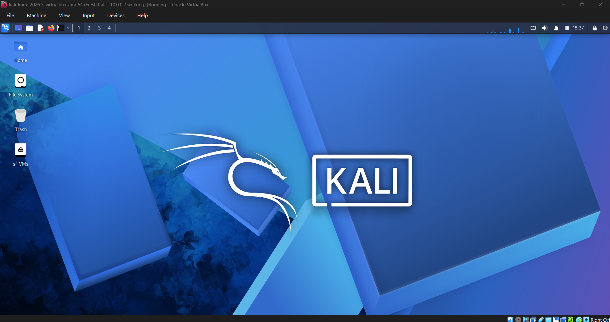
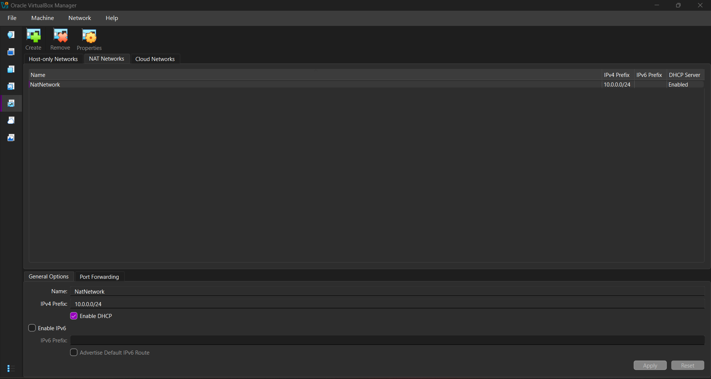
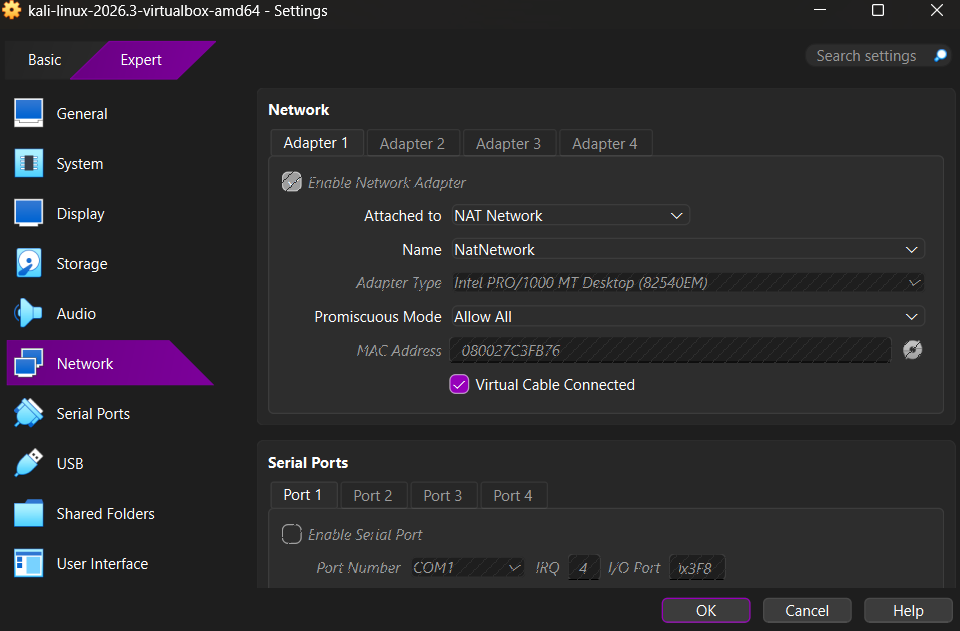
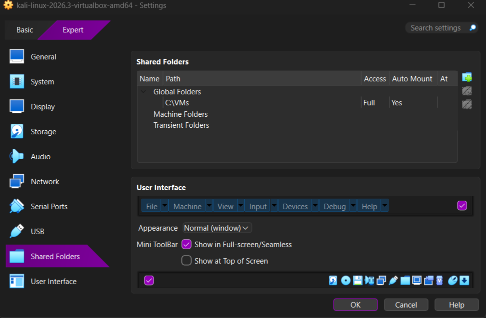
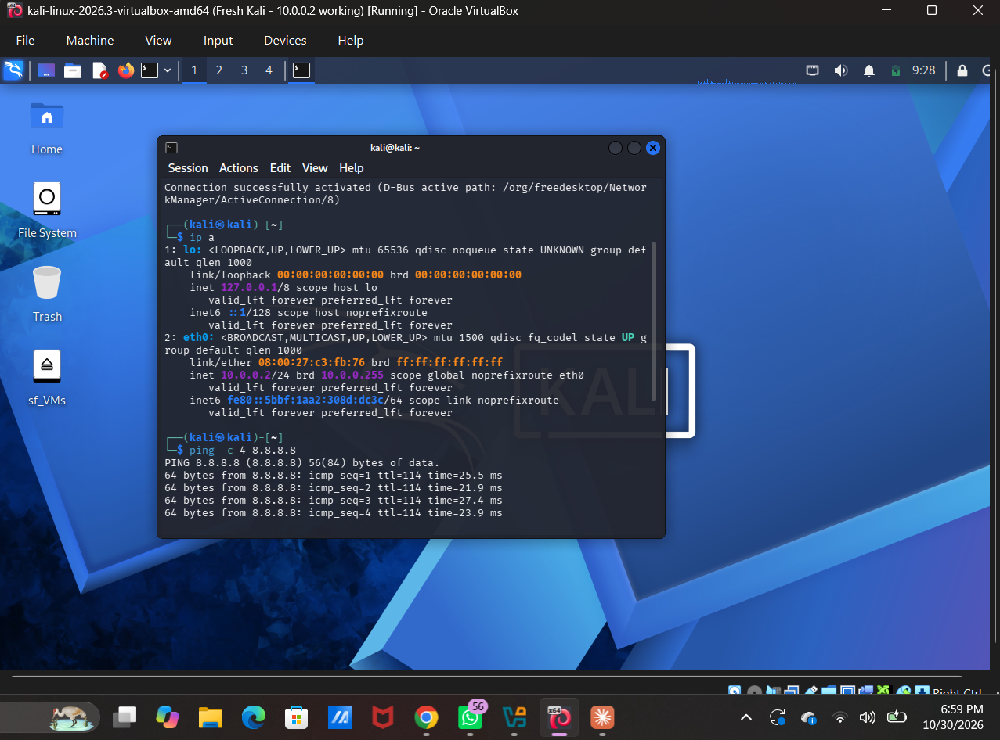
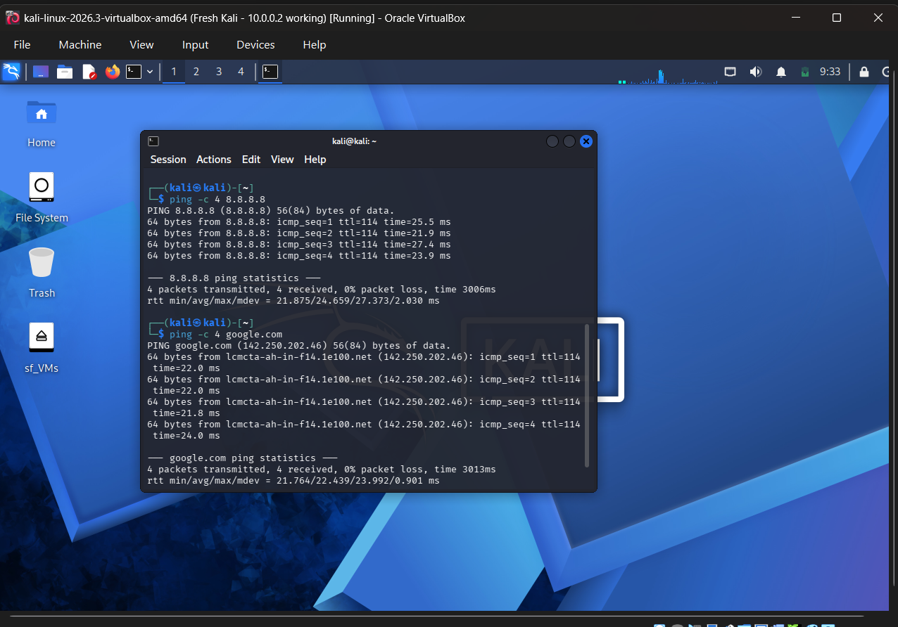

# NETWORKWALKS-NAADIYA-B084L-WK1-PM1-CYBERSECURITY-LAB-SETUP
Cybersecurity lab setup using VirtualBox and Kali Linux on an isolated NAT Network (Week 1 project, Networkwalks)
# 🔐 Cybersecurity Lab Environment Setup

**My first Networkwalks project: a private virtual lab for ethical hacking practice**


---

## 📌 Project Overview

For Week 1 of the Networkwalks Cybersecurity Program, I built a virtual cybersecurity lab on my own laptop using **VirtualBox** and **Kali Linux**.

The lab runs on its own private virtual network. This keeps my practice separate from my home network and lets me add more virtual machines later to use as targets.

---

## 🎯 Objectives

- Install VirtualBox as the virtualization base
- Set up Kali Linux as the attacker machine
- Create a NAT Network in the `10.0.0.0/24` subnet
- Enable shared clipboard and drag and drop
- Share a folder between my laptop and Kali
- Give Kali the static IP `10.0.0.2/24`
- Confirm Kali has full internet access
- Save a snapshot so I can restore a working lab at any time

---

## 🏗️ Lab Architecture



My laptop runs VirtualBox, and Kali Linux sits on a private NAT Network. More machines (Windows, Android) can join the same network later.

---

## ⚙️ Lab Configuration

| 🧩 Component | ⚙️ Configuration |
|---|---|
| 🖥️ Host OS | Windows 11 Home |
| 🧠 Host RAM | 16 GB |
| ⚡ Processor | Intel Core 3 100U |
| 🧰 Hypervisor | VirtualBox 7.2.22 |
| 🐉 Security OS | Kali Linux 2026.3 |
| 🧠 Kali RAM | 4096 MB |
| 🌐 Virtual Network | NAT Network (`NatNetwork`) |
| 📡 Network Address | 10.0.0.0/24 |
| 🐧 Kali IP Address | 10.0.0.2/24 |
| 🚪 Default Gateway | 10.0.0.1 |
| 🌍 DNS Server | 8.8.8.8 |

---

## 🪜 Setup Steps

### Step 1. Install 7-Zip
Kali's VirtualBox image comes as a compressed `.7z` file, so I installed 7-Zip to extract it.

### Step 2. Install VirtualBox
I downloaded the latest VirtualBox from the official website and installed it on Windows.

### Step 3. Create the NAT Network
In VirtualBox I opened **File → Tools → Network → NAT Networks** and created:

- Name: `NatNetwork`
- IPv4 Prefix: `10.0.0.0/24`
- DHCP: Enabled
- IPv6: Disabled



### Step 4. Import Kali Linux
I downloaded the Kali VirtualBox image, extracted it into a permanent folder, and opened the `.vbox` file to import it. Then I configured the VM:

- Network Adapter 1: NAT Network → `NatNetwork`
- Promiscuous Mode: Allow All
- Shared Clipboard and Drag'n'Drop: Bidirectional
- Shared folder: my Windows Downloads folder (Auto-mount, Full access)




### Step 5. Set the static IP on Kali
In Kali I opened **Edit Connections → Wired connection 1 → IPv4 Settings** and set:

```
Method:  Manual
Address: 10.0.0.2
Netmask: 24
Gateway: 10.0.0.1
DNS:     8.8.8.8
```



### Step 6. Take a snapshot
After everything worked, I took a VirtualBox snapshot of the Kali VM as a clean baseline I can return to.


---

## 🔎 Verification

| ✅ Test | 🧾 Command | 🎯 Expected result |
|---|---|---|
| Check IP address | `ip a` | `10.0.0.2/24` shown |
| Internet access | `ping -c 4 8.8.8.8` | Replies received |
| DNS working | `ping -c 4 google.com` | Name resolves, replies received |



---

## 🐞 Problems Encountered & Solutions

### Problem 1. VM would not start: "Could not open the medium" (VERR_FILE_NOT_FOUND)

**What happened:** The Kali VM failed at startup because VirtualBox could not find its virtual disk (`.vdi`). The path in the error pointed to a Windows `Temp` folder.

**Cause:** I had opened the `.vbox` file directly from inside the `.7z` archive. 7-Zip only unpacked the files temporarily, and Windows later removed them.

**Solution:**
1. Removed the broken VM from VirtualBox (**Remove → Remove Only**).
2. Extracted the entire archive with 7-Zip into a permanent folder.
3. Opened the `.vbox` file from that folder to import the VM again.
4. Re-applied the network and shared folder settings.

### Problem 2. Network connection turned itself off after setting the static IP

**What happened:** After saving the manual IP settings, the wired connection switched off by itself and Kali had no network.

**Cause:** This is a known issue with newer VirtualBox 7 and Kali versions, related to the duplicate address check on static IPs.

**Solution:** I ran these commands in the Kali terminal, one at a time:

```bash
sudo nmcli connection modify "Wired connection 1" ipv4.dad-timeout 0
sudo nmcli connection down "Wired connection 1"
sudo nmcli connection up "Wired connection 1"
```

After that, `ip a` showed `10.0.0.2/24` and the ping tests worked.

---

## 💡 What I Learned

- **Virtual networking:** A NAT Network lets several VMs talk to each other and still reach the internet, which suits a multi-machine lab.
- **Static IP setup:** How to configure the address, netmask, gateway and DNS in Kali, and how to check them with `ip a` and `ping`.
- **Archives matter:** A compressed VM image must be fully extracted before importing it.
- **Troubleshooting:** Reading error messages carefully (the file path in the error showed the real cause).
- **Snapshots:** A clean snapshot gives me a safe point to return to before trying risky experiments.
- **Documentation:** Writing down steps, problems and fixes helps me and others repeat the setup.

---

## 🔐 Security & Ethical Use

This lab is for education only. It runs on my own laptop in an isolated virtual network. Security tools should only be used on systems I own or have written permission to test.

---

## 🔗 Tools & Resources

- **7-Zip:** https://7-zip.org/download.html
- **VirtualBox:** https://virtualbox.org/wiki/Downloads
- **Kali Linux:** https://kali.org/get-kali

---

## 👤 Author

**Naadiya Sabrin**
Cybersecurity Program, Networkwalks, Batch B084L

LinkedIn:www.linkedin.com/in/naadiya-sabrin-6a600b2a1

---

## 📌 Project Information

**Program:** Cybersecurity at Networkwalks | **Week:** 01 | **Project:** WK1-PM1 Cybersecurity Lab Setup | **Repository:** GitHub
